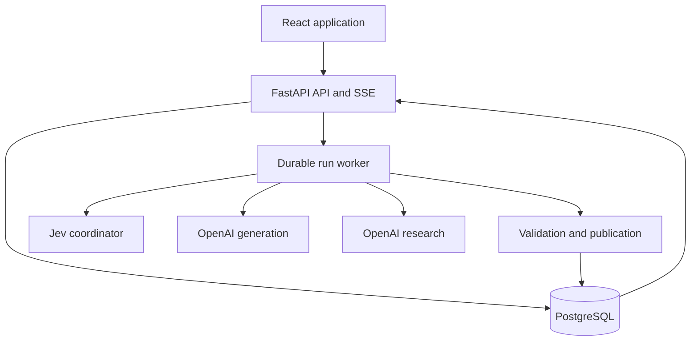
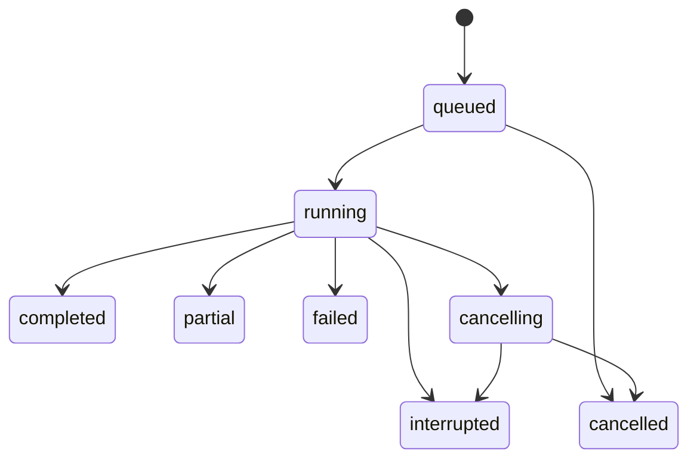

# Technical requirements

## Architecture

Use a modular monolith. One Python application serves REST endpoints, durable SSE events, a small job worker, and the compiled React SPA. PostgreSQL stores application state. OpenAI and Jev are external services reached only from the backend.

A single Uvicorn worker is a first-release constraint. Its worker loop claims persisted jobs; do not start anonymous background generations tied only to an HTTP request. Two distinct sessions may execute concurrently; a session has at most one active run. Redis, a separate queue service, and an agent framework are unnecessary for this scope.

## Stack and repository layout

Node 24, Python 3.12, PostgreSQL 16. Choose compatible current releases of React, TypeScript, Vite, FastAPI, Pydantic 2, SQLAlchemy 2, Alembic, asyncpg, HTTPX, and the official OpenAI Python SDK at implementation time. Lock exact resolved versions. Frontend: React Router, TanStack Query, a small Zustand store for draft/UI state, accessible Radix primitives, and CSS variables/Tailwind. Tests: pytest, Vitest, and Playwright.

| Directory | Responsibility |
| --- | --- |
| `backend/app/api/` | Routers and request/response validation |
| `backend/app/domain/` | Public models, internal run/decision models, enums |
| `backend/app/services/` | Session, context, orchestration, research, export, evaluation services |
| `backend/app/providers/` | OpenAI, Jev, and deterministic demo adapters |
| `backend/app/persistence/` | SQLAlchemy models, repositories, transactions |
| `backend/app/workers/` | Claiming, cancellation, event publication, recovery |
| `backend/app/prompts/` | Versioned templates and personality configuration loading |
| `backend/migrations/` | Alembic migrations |
| `frontend/src/features/` | workspace/sidebar, folders, search, rooms, conversation, ideas, personas, lab, settings |
| `frontend/src/components/` | AppShell, Sidebar, ThemeSwitch, PersonaRoster, PersonaAvatar, TurnGroup, DetailsDrawer |
| `frontend/src/styles/` | Semantic dark/light CSS variables and approved static artwork |
| `frontend/src/api/` | Generated types, REST client, SSE reconnection |
| `tests/` | Contract, integration, browser, and live smoke checks |
| `scripts/` | Seed, evaluation, export, and diagnostic commands |

## Run lifecycle

Persist the user message, immutable run snapshot, and `queued` event in one transaction. Return HTTP 202 before provider work. The worker claims a run, marks it running, and executes stages: prepare context → route → optional research → draft → validate → publish → optional next contribution → finalize memory.

Legal statuses: `queued`, `running`, `cancelling`, `completed`, `partial`, `cancelled`, `failed`, `interrupted`. The five terminal statuses are completed, partial, cancelled, failed, and interrupted. Stage is a separate field and never a replacement for status.

Store a single active-run constraint per session for queued/running/cancelling states. Claim jobs using a transaction and row locking. Each run has a worker owner, heartbeat, cancellation flag, and snapshot. On startup, mark orphaned running/cancelling jobs interrupted; preserve published messages and traces. Queued jobs can start normally. Never automatically retry a generation whose outcome after a process crash is unknown.

## Submission, concurrency, and replay

- Every paid-work creation accepts an `Idempotency-Key` UUID. Persist key, route, canonical body hash, and response. Identical retries return the same run; a reused key with a different body is 409.
- Chat organization uses a separate `organization_version`: title, folder and pin changes never alter a captured generation context. Archive and delete require an idle chat. Folder changes are transactional; deleting a folder only unfiles its chats. See document 14.
- Context-changing requests carry `expected_version`. Stale versions return 409 with the latest session version. Reject session settings, brief changes, forks, and new turns while a run is active; let the UI retain unsent text.
- Feedback and saved-idea metadata can change during a run; they do not mutate its captured context. They are included in the next run's snapshot.
- A completed published contribution, its source references, and its event are committed atomically. Use a uniqueness constraint on `(run_id, contribution_index)` and assign message sequence numbers transactionally.
- SSE is a read-only subscription. Reconnection never creates provider work. Replay events after `Last-Event-ID`, deduplicate by event ID, and fetch a fresh run snapshot if replay history is unavailable.
- Keep provider output buffered until validation. Publish a completed contribution card, not provisional text that may disappear. Report real progress stages through SSE; do not simulate token typing.

## Cancellation and failures

Stop sets the cancellation flag transactionally and signals the current task. Check it before every provider call and before publishing. Close local HTTP streams where supported; in-flight remote work may still be billed. Ignore late unpublished output, but retain any usage record obtainable. Already published contributions remain. Finishing after Stop must not enqueue another participant.

Use one centralized retry policy, including SDK settings, to avoid multiplicative retries. Retry only eligible transient failures at most once within the per-run attempt cap, honoring provider retry hints. Do not retry invalid credentials or an unchanged invalid payload. Log ambiguous timeouts as unknown usage; do not silently resubmit them. An explicit user Retry creates a new linked run for missing contributions, not a replay of successful ones.

Jev timeout or invalid output falls back to deterministic coordination and records a degraded flag. Generation failure cannot be hidden by demo output. Research failure permits an explicitly unsourced/speculative continuation if the user question remains answerable; otherwise ask for missing evidence. A run with some successful output and failed requested contributions is partial.

## Context and memory

Use explicit messages per call, with a new persona instruction block. Do not share provider-side conversation IDs or hidden reasoning between personalities. The database is the system of record. Persist public contributions and concise model-generated metadata; do not request or store hidden chain-of-thought.

Always retain current user input, user-confirmed brief, active constraints, relevant reply target, selected-profile snapshot, and references needed by the task. Add bounded recent messages, pinned ideas, open questions, and summaries. If required material alone exceeds limits, ask the user to narrow it. Never silently truncate user constraints. After a turn, create a provenance-bearing memory update; the schema identifies which messages support each item. Summary failure does not erase a successful conversation.

## Local deployment and data handling

Docker Compose runs `app` and `db`; publish only `127.0.0.1:8000:8000`. PostgreSQL stays on the private Compose network. Within the container the app listens on 0.0.0.0, with one worker. Serve the SPA and API from the same origin. Development may use Vite on localhost with an explicit API proxy.

Apply trusted-host checks, exact allowed origins, JSON-only mutations, and rejection of cross-site browser mutation requests. Sanitize rendered Markdown and source URLs; allow only HTTP(S) citation links. API keys remain environment-only. Log operational metadata by default, not full prompts or secrets. Provider content leaves the machine; deleting a local session does not promise deletion from provider retention systems. Use OpenAI `store=false` and application-owned history.

## Frontend state and workspace persistence

Persist chats, folders, pin/archive state and organization versions in PostgreSQL. Keep theme, sidebar width state, open folder IDs and per-chat composer drafts in versioned browser local storage. Never store API keys there. Split drafts by session ID or new-chat/folder key; hydrate the selected chat before rendering its composer. A failed submit keeps its draft. Switching routes closes the old SSE view but does not cancel the backend run; reconnect to persisted events when returning. Poll lightweight history while any row has an active run; stop polling when idle and reconcile on focus. UI preferences must not enter model prompts or benchmark configurations.

Use a small component hierarchy and semantic CSS tokens, not duplicate dark/light pages. Source static portraits from the provided images as described in `ui/README.md`; no runtime image generation. Use CSS container queries or measured available content width so opening the sidebar reflows cards before text becomes cramped. Both themes are complete P0 behavior.

## Operational defaults and performance

`config/app.defaults.json` is authoritative for counts and timeouts. Defaults favor deliberate interaction: three auto contributions, up to eight panel contributions, one research job per turn, at most one regeneration across the turn, two concurrent generations, and a total provider-attempt ceiling. A watchdog ends a stuck run and preserves partial results. Unlimited budget does not remove cancellation, timeout, concurrency, or token limits.

Show a queued/progress state immediately. Record stage timing, first published contribution latency, whole-turn latency, provider calls, token categories, model identifiers, and failures. Treat latency targets as local measurements, not provider guarantees. Estimate cost only from versioned configured rate cards; show unknown when rates or usage are missing. There is no automatic model substitution when the configured model is unavailable.
